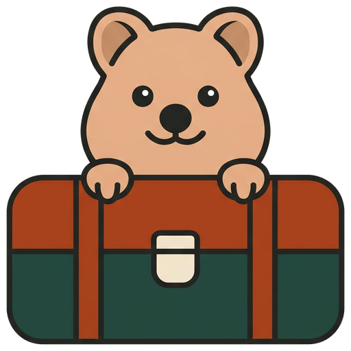
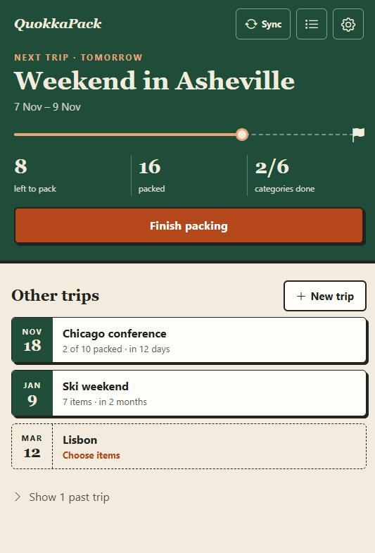
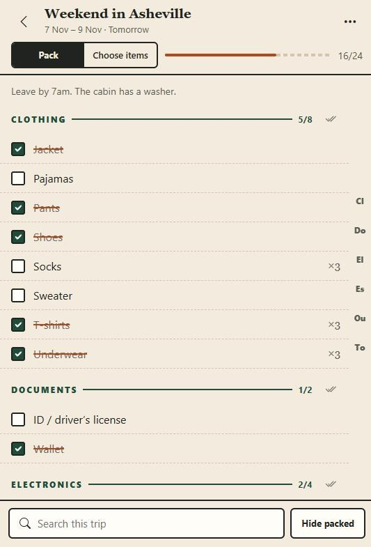
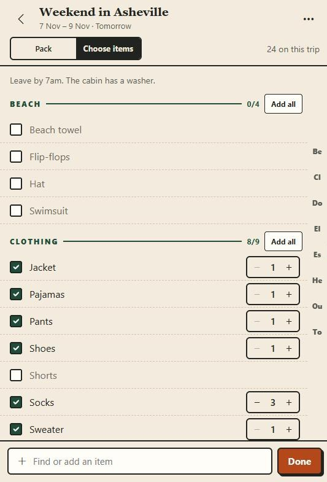
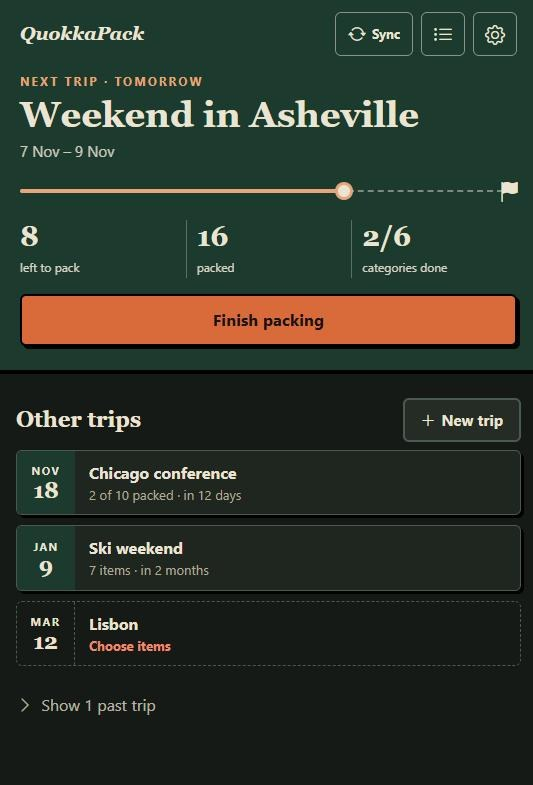
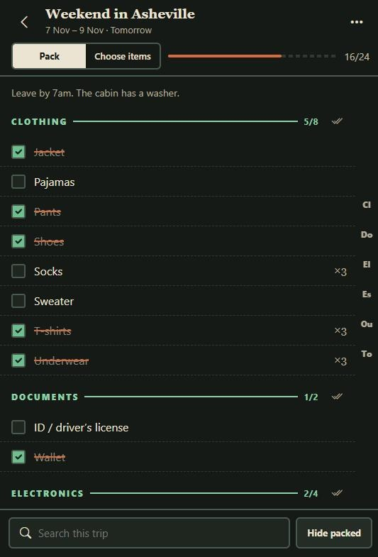

  

<h1 align="center">QuokkaPack</h1>

  Packing lists for every trip. Keep one catalog of everything you might bring, pick from it for each trip, and check
  things off as you pack.

<strong><a href="https://pavelgutin.github.io/QuokkaPack/">Open the app</a></strong>

  
  
  

  
  

No account needed. It works offline once it has loaded, and your lists stay on your device unless you turn on Google
Drive sync.

## Getting started

The first time you open QuokkaPack, it asks whether you're new or already use it on another device.

- **New:** choose where your lists live, either on this device only or on this device plus your Google Drive. Then
  start with a ready-made catalog of about 50 common items, or start empty.
- **Already using it:** connect the same Google Drive account to bring your lists over, or restore a backup file.

## Install it on your phone or computer

- **Android (Chrome):** open the app, then tap **⋮ → Install app** (or **Add to Home screen**).
- **iPhone or iPad (Safari):** tap **Share → Add to Home Screen**.
- **Desktop Chrome or Edge:** click the install icon at the right end of the address bar.

Installed, it opens in its own window like any other app. You can also install it from the welcome screen or from
**Sync & settings → Install the app**, which opens your browser's install dialog where the browser allows it and
shows the steps where it doesn't. On Android, removing the icon from the home screen may leave the app installed:
uninstall it from the app list to get the install option back.

## What you can do

**Plan trips**
- Create a trip with a name and optional dates and notes.
- Start it from whole categories (Clothing, Toiletries, and so on), or copy the list from an earlier trip.
- Your next trip is shown at the top with a countdown and how much is left to pack. Past trips are tucked away.

**Choose what to bring**
- Switch a trip to **Choose items** to add or remove things, set quantities, or add a whole category at once.
- Type a name that isn't in your catalog yet and add it on the spot. It's saved to the catalog for future trips.

**Pack**
- Check items off as they go in the bag. Each category shows how many are done, and a finished category folds
  away.
- Search the list, hide what's already packed, or check off a whole category in one tap.
- Jump between categories with the letters on the right edge.

**Keep your catalog tidy**
- Rename anything by tapping its name, move items between categories, and archive what you no longer use. Archived
  items stay on old trips but don't show up for new ones.

**Undo**
- Deleting, archiving, moving, unchecking everything, restoring a backup or erasing can be undone from the message
  that pops up.

**Light or dark**
- QuokkaPack follows your device's light or dark setting. You can pick one under **Sync & settings → Appearance**.

## Your data and backups

Your lists are saved in the browser on the device you're using. Clearing the browser's site data, using a private
window, or switching to a new phone means starting over, unless you have a backup or Google Drive sync.

**Google Drive sync (optional)**
- Turn it on during setup or later under **Sync & settings**. Use the same Google account on each device to keep them
  in step.
- QuokkaPack keeps one hidden file in your Drive. It can't see any of your other files, and the file doesn't appear in
  your Drive's file list. You can see it, and delete it, in Google Drive under **Settings → Manage apps**.
- The cloud button at the top of your trips shows whether everything is backed up. **Not backed up** means there are
  changes on this device that aren't in Drive yet. Tap it to sync. **Sync** checks Drive for changes from your other
  devices.
- Want it to sync on its own? Turn on **Sync automatically** in Sync & settings. Your browser may then sometimes show
  an "Allow this site to open?" prompt or a brief Google window when QuokkaPack signs in again.
- **Disconnect** stops syncing. Your lists stay on the device.

**Backup file**
- **Sync & settings → Download backup** saves everything as one file. **Restore file** loads it in any browser.

**Keeping your data on a device**
- Browsers can clear website data to free up space. **Ask the browser to keep my data** in Sync & settings asks it
  not to. Some browsers decide on their own, and installing the app makes a yes more likely.

**Starting over**
- **Sync & settings → Erase everything on this device** deletes your trips and catalog from that browser.

## Privacy

QuokkaPack has no server and no account, and it doesn't collect analytics. Your lists only leave your device if you
turn on Google Drive sync, and then they go to your own Drive. Read the full
[privacy policy](https://pavelgutin.github.io/QuokkaPack/privacy.html).

---

Building or changing QuokkaPack? See [DEVELOPMENT.md](DEVELOPMENT.md). Licensed under [MIT](LICENSE).
